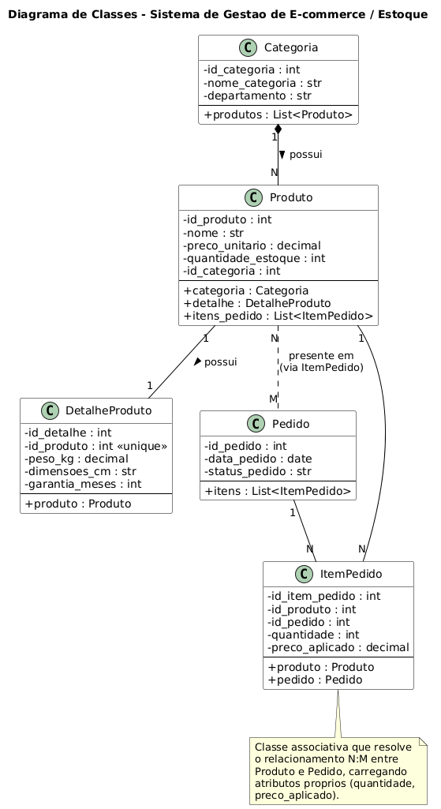
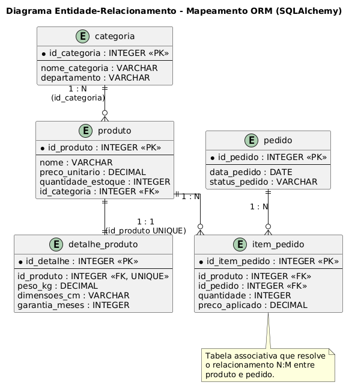

# Sistema de Gestao de E-commerce/Estoque - Camada de Persistencia com SQLAlchemy (ORM)

Projeto didatico que implementa a camada de persistencia de um pequeno
sistema de gestao de e-commerce/estoque (Categoria, Produto,
DetalheProduto, Pedido e ItemPedido), cobrindo os tres tipos
classicos de relacionamento entre entidades:

| Relacionamento | Entidades | Mecanismo |
|---|---|---|
| **1 : N** | `Categoria` &rarr; `Produto` | FK `id_categoria` em `Produto` |
| **1 : 1** | `Produto` &harr; `DetalheProduto` | FK `id_produto` com `UNIQUE` em `DetalheProduto` |
| **N : M** | `Produto` &harr; `Pedido` | Classe associativa `ItemPedido` (com atributos proprios: `quantidade`, `preco_aplicado`) |

Toda a persistencia e feita via **SQLAlchemy ORM** (Declarative +
`relationship()`), sem nenhuma linha de SQL escrita a mao. O banco de
dados utilizado e **SQLite**, por simplicidade e por dispensar
instalacao de servidor.

---

## 1. Estrutura do repositorio

```
.
├── README.md
├── requirements.txt
├── build_notebook.py              # script auxiliar que gerou o notebook (nao e parte do entregavel de execucao)
├── diagrams/
│   ├── class_diagram.puml         # diagrama de classes (codigo-fonte PlantUML)
│   ├── class_diagram.png          # diagrama de classes (imagem renderizada)
│   ├── er_diagram.puml            # diagrama entidade-relacionamento (codigo-fonte PlantUML)
│   └── er_diagram.png             # diagrama entidade-relacionamento (imagem renderizada)
├── src/
│   └── orm_ecommerce/
│       ├── __init__.py
│       ├── database.py            # configuracao do engine/sessao SQLAlchemy
│       ├── models.py              # classes entidade (ORM) e relacionamentos
│       └── repositories.py        # camada Repository (CRUD) para cada entidade
└── notebooks/
    └── testes.ipynb               # testes interativos da camada de persistencia (com dados sinteticos)
```

---

## 2. Modelo de dominio

```
[DetalheProduto] --- (1:1) --- [Produto] --- (N:1) --- [Categoria]
                                    |
                                  (N:M via ItemPedido)
                                    |
                                 [Pedido]
```

### 2.1. Diagrama de Classes

Codigo-fonte: [`diagrams/class_diagram.puml`](diagrams/class_diagram.puml)



### 2.2. Diagrama Entidade-Relacionamento (mapeamento ORM)

Codigo-fonte: [`diagrams/er_diagram.puml`](diagrams/er_diagram.puml)



Para re-renderizar os diagramas (caso os `.puml` sejam alterados), e
necessario ter **Java** instalado e o `plantuml.jar` disponivel (veja
a secao 5 - "Como regerar os diagramas").

---

## 3. Pre-requisitos

- Python 3.10+
- `pip`
- (Opcional, apenas para regerar as imagens dos diagramas) Java 11+ e Graphviz

---

## 4. Como executar o projeto

### 4.1. Criar e ativar um ambiente virtual (recomendado)

```bash
python3 -m venv .venv
source .venv/bin/activate        # Linux/Mac
# .venv\Scripts\activate         # Windows
```

### 4.2. Instalar as dependencias

```bash
pip install -r requirements.txt
```

### 4.3. Testar a camada de persistencia via script Python (opcional, rapido)

Um teste rapido, direto pelo interpretador Python, sem precisar do
Jupyter:

```bash
cd src
python3 -c "
from orm_ecommerce import Database, Categoria
db = Database('ecommerce.db')
db.create_all()
print('Banco de dados e tabelas criados com sucesso!')
"
```

Isso cria o arquivo `ecommerce.db` (SQLite) com as 5 tabelas do
modelo, ja prontas para uso.

### 4.4. Executar o notebook de testes (recomendado)

O notebook `notebooks/testes.ipynb` e o entregavel principal de
validacao: ele **recria o banco do zero**, **popula dados sinteticos**
e **testa, passo a passo e com documentacao em Markdown**, os tres
relacionamentos (1:N, 1:1 e N:M), alem de operacoes de `update` e
`delete`.

```bash
jupyter notebook notebooks/testes.ipynb
```

Ou, para executa-lo do inicio ao fim via linha de comando (gerando um
novo notebook com as saidas atualizadas):

```bash
jupyter nbconvert --to notebook --execute --inplace notebooks/testes.ipynb
```

Ao final da execucao, um arquivo `notebooks/ecommerce.db` sera criado
com os dados sinteticos de teste.

> O notebook ja foi executado uma vez neste repositorio, entao ele
> pode ser aberto e lido diretamente (com as saidas visiveis) sem
> precisar rodar nada, caso o objetivo seja apenas revisar os
> resultados dos testes.

---

## 5. Como regerar os diagramas (opcional)

Os diagramas ja estao renderizados em `diagrams/*.png`. Caso queira
regera-los apos editar os arquivos `.puml`:

```bash
# Baixe o plantuml.jar (uma vez), a partir da pagina de releases oficial:
# https://github.com/plantuml/plantuml/releases

cd diagrams
java -jar /caminho/para/plantuml.jar -tpng class_diagram.puml er_diagram.puml
```

Isso gera/atualiza `class_diagram.png` e `er_diagram.png`.

---

## 6. Sobre os dados sinteticos

Os dados usados nos testes do notebook (produtos, precos, quantidades,
pedidos etc.) sao **totalmente ficticios**, criados apenas para
exercitar a camada de persistencia. Cada etapa da populacao dos dados
esta documentada em celulas Markdown dentro do proprio notebook
(`notebooks/testes.ipynb`), na secao **"4. Populando dados
sinteticos"**, incluindo:

- 2 Categorias (Perifericos, Vestuario)
- 4 Produtos (distribuidos entre as categorias, testando 1:N)
- 4 Detalhes de Produto (um por produto, testando 1:1)
- 3 Pedidos
- 7 Itens de Pedido (vinculando produtos a pedidos, testando N:M)

O notebook tambem testa operacoes de `update` (alteracao de preco,
status de pedido e baixa de estoque) e `delete` (remocao de um item
de pedido, sem afetar produto ou pedido relacionados).

---

## 7. Resumo tecnico da modelagem

- **ORM utilizado:** SQLAlchemy (Declarative Mapping + `relationship()`)
- **Banco de dados:** SQLite (arquivo local, sem necessidade de servidor)
- **Padrao de projeto:** Repository (uma classe `*Repository` por entidade, com `create`, `load_from_id`, `load_all`, `update`, `delete`)
- **Relacionamento N:M "rico":** implementado como *association object* (`ItemPedido`), pois carrega atributos proprios (`quantidade`, `preco_aplicado`), e nao apenas uma tabela de associacao simples
- **Integridade 1:1:** garantida por `unique=True` na FK `id_produto` de `DetalheProduto`
